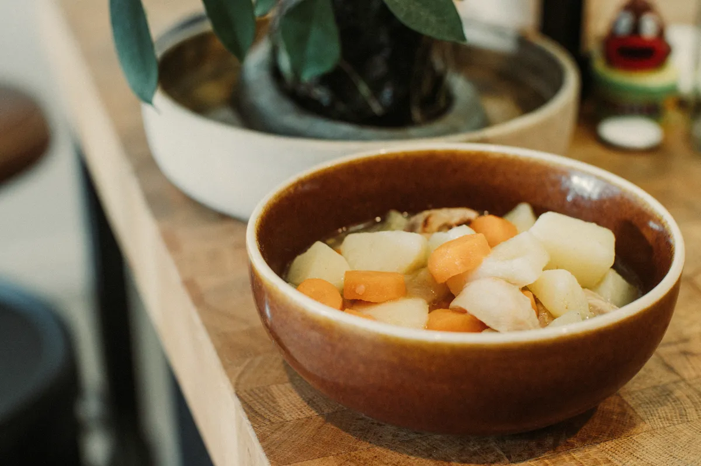

小雪，是冬天的第二个节气。《月令七十二候集解》说，十月中，雨下而为寒气所薄，凝而为雪，小者未盛之辞。小雪三候：一候虹藏不见，彩虹收了踪影；二候天气上升，地气下降；三候闭塞而成冬，天地不通，万物蛰伏。到了这个时节，北方初雪将至，南方忙着腌腊肉、晒鱼干，把丰盛留给更冷的日子。天一冷，灶上就可以炖一锅汤了——一碗热汤，是小雪最踏实的过法。

炖汤的材料很家常。牛腩切大块，冷水下锅，焯透了捞出来，把浮沫洗干净；番茄两只，顶上划个十字，烫一烫好去皮；再配一根白萝卜、两枚干辣椒、一小把提前泡发的白豆。砂锅坐上灶，肉先进，加足热水，大火滚开之后转小火，让汤面只保持着将滚未滚的样子——火太急，汤色就浑了。

番茄和白豆随后下锅，萝卜最后放。萝卜熟得快，放早了会散在汤里，只剩甜味，找不到人。火候到后半程，辣椒的暖意先出来：不是辣口的那种辣，是从喉咙一路暖到胃里的暖。番茄慢慢化进汤里，把汤色染成浅浅的红亮。这时候不要勤揭盖，蒸汽跑一次，香气就薄一分。炖汤急不得，你守着时间，时间才肯把味道交出来。

<figure>

<figcaption>一锅汤炖到后半程，食材沉底，汤色渐浓。</figcaption>
</figure>

食材与做法

<b>食材</b>：牛腩 600 克 · 番茄 2 只 · 白萝卜 1 根 · 白豆 1 小把（提前泡发） · 干辣椒 2 枚 · 生姜 3 片 · 盐适量

<b>做法</b>：① 牛腩冷水下锅焯透，洗净浮沫。② 砂锅加足量热水，下肉与姜片，大火滚开，转小火炖 1 小时。③ 下番茄块与白豆，再炖 40 分钟。④ 下萝卜块与干辣椒，炖 25 分钟，至萝卜透亮。⑤ 关火前加盐调味，静置 10 分钟再上桌。

注：参考做法，火候以灶具为准。

汤炖好，先别急着盛。关火焖十分钟，让萝卜把汤味再吃回去一截。盛汤的碗提前用热水烫过——凉碗盛热汤，香气先折一半。这些小地方不写在菜谱上，是过日子过出来的。

汤在灶上炖着，屋里也可以跟着入冬。落地灯可以从墙角挪到沙发边，光就落在手边；厚毯子搭上扶手，探手就能拽过来盖住腿；窗台上摆了整个夏天的绿植，往里挪一挪，避开窗缝漏进来的风。暖居不是添置多少东西，是把已经有的东西，挪到离人更近的地方。

<figure>

<figcaption>厚毯子搭上沙发，灯挪到手边，屋角先暖起来。</figcaption>
</figure>

站长手记小雪一到，屋里比屋外先知道冬天来了。窗上慢慢起雾，锅里咕嘟咕嘟，热气一冒，日子就跟着慢下来。这一锅汤不讲究排场，牛腩、番茄、白萝卜，都是菜市场里最顺手的食材，炖到软烂，喝下去，从胃里暖到手脚。所谓过冬，不是什么大事，不过是认真吃一顿热饭，把灯挪到手边，把毯子搭上沙发，等雪落下来。天冷了，照顾好自己，就是正经事。

汤盛出来，可以先捧着碗暖一会儿手，再慢慢喝。小雪天黑得早，屋里的灯黄澄澄的。小雪不过是冬天递来的第一张帖子，接住了，后面的节气，一个一个慢慢过。

