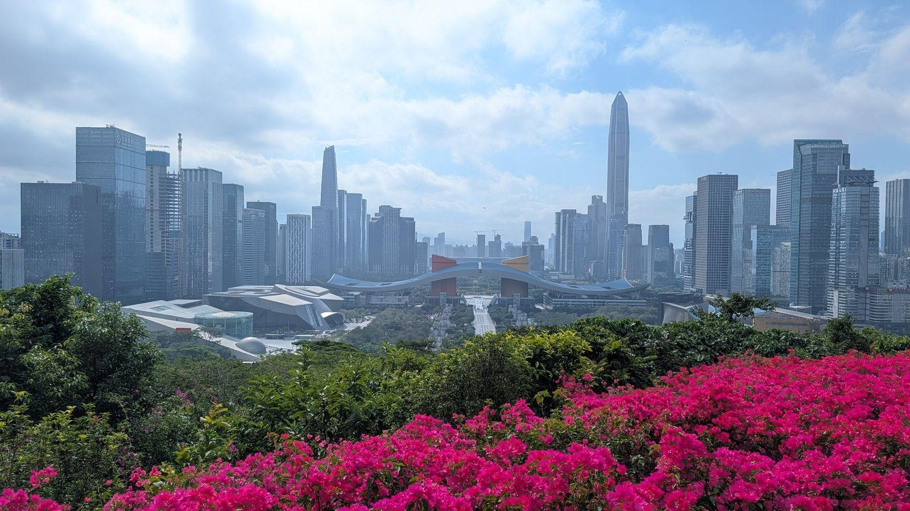
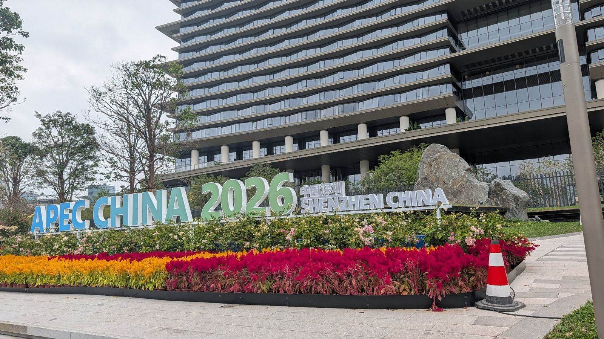
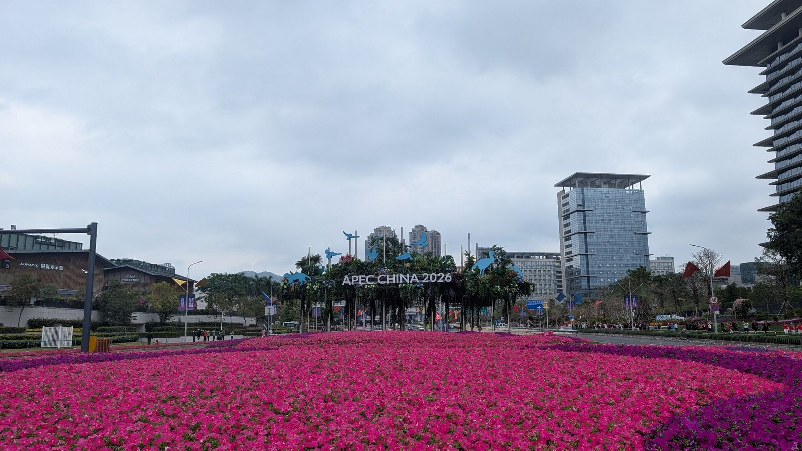
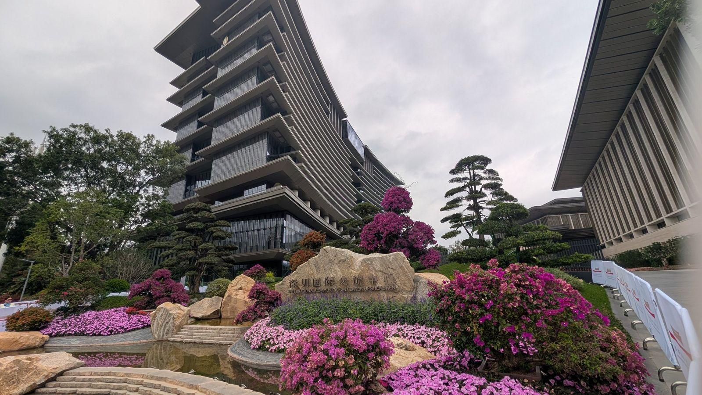
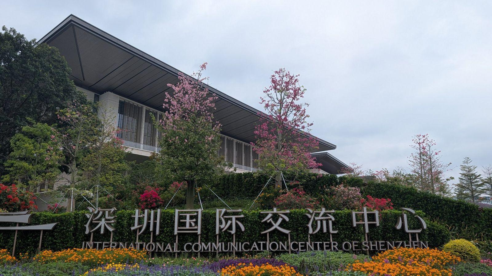
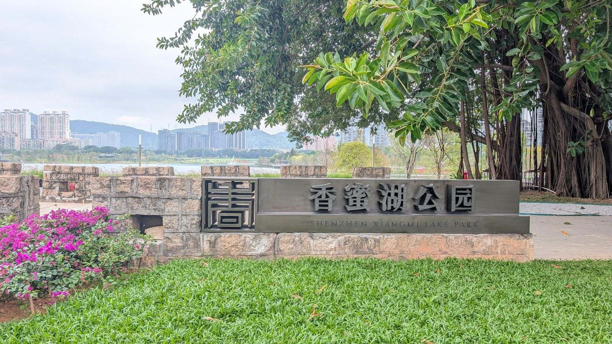
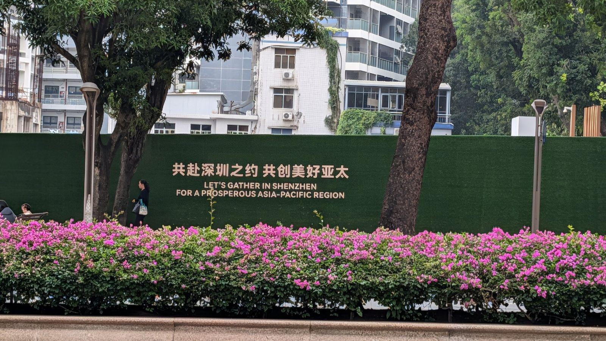
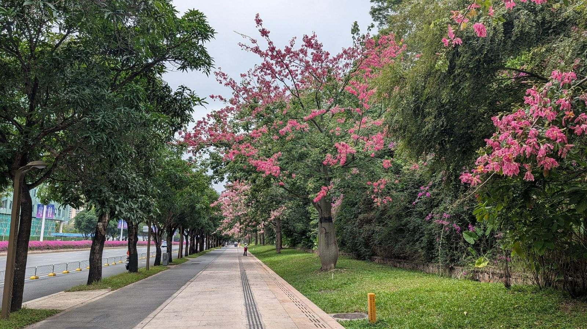
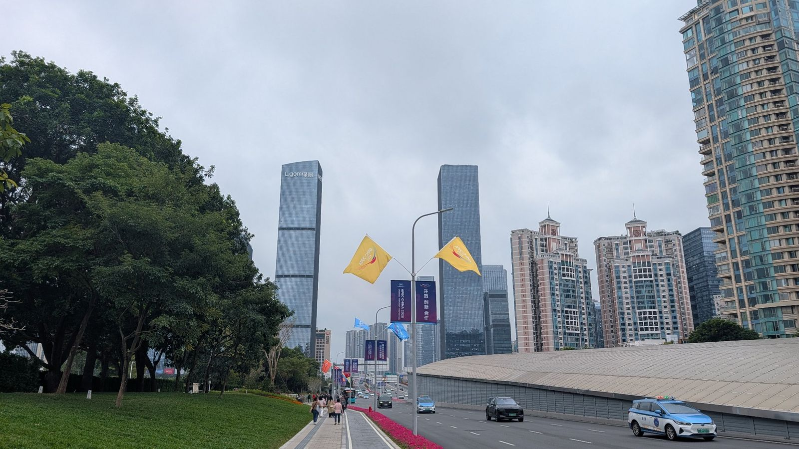
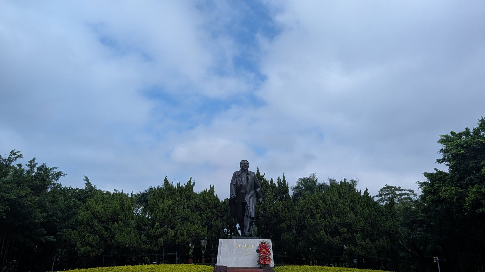

2026 年，APEC 会议来到中国深圳。会议落幕之后，城里还留着不少会议的痕迹：深圳国际交流中心门前的花坛和字牌、街道上的 APEC 旗帜，也留下了莲花山与香蜜湖一带初冬的花木。这组照片摄于 2026 年 11 月，一共十张。

      <figure>
        
        <figcaption>莲花山公园山顶望向福田中心区，市民中心与平安金融中心隔着中轴绿地相对，前景的簕杜鹃开得正盛。</figcaption>
      </figure>
      <figure>
        
        <figcaption>「APEC CHINA 2026 中国深圳」立体字牌立在花坛前，花坛里鸡冠花红黄相间，身后就是深圳国际交流中心主楼。</figcaption>
      </figure>
      <figure>
        
        <figcaption>整片粉色花海铺向路口，花海尽头是写着「APEC CHINA 2026」的绿雕，上面立着鸟形装饰。</figcaption>
      </figure>
      <figure>
        
        <figcaption>深圳国际交流中心门前庭院：刻着中心名字的景石立在水池边，主楼层层退台，水边是盛开的三角梅和修剪整齐的罗汉松。</figcaption>
      </figure>
      <figure>
        
        <figcaption>「深圳国际交流中心」字牌嵌在绿篱之上，牌前花坛橙、黄、紫三色，字牌上方两株美人树开着粉花。</figcaption>
      </figure>
      <figure>
        
        <figcaption>香蜜湖公园入口石牌，牌身刻着「香蜜湖公园」，身后就是香蜜湖和湖对岸的楼群。</figcaption>
      </figure>
      <figure>
        
        <figcaption>绿墙上写着「共赴深圳之约 共创美好亚太」，墙前一排簕杜鹃开得正盛。</figcaption>
      </figure>
      <figure>
        
        <figcaption>美人树行道：人行道一侧绿树成荫，美人树满冠粉花，影子落在干净的人行道上。</figcaption>
      </figure>
      <figure>
        
        <figcaption>街道两侧的路灯杆上，APEC 的黄色旗帜和「开放 · 创新 · 合作」道旗一路排开。</figcaption>
      </figure>
      <figure>
        
        <figcaption>莲花山公园山顶广场，邓小平同志塑像立在成片的柏树前，像前摆着一束鲜花。</figcaption>
      </figure>
      
会开完了，人也散了，花还开着。这几天在莲花山和香蜜湖一带走走，公园和街道都回到了平常日子。热闹留给了会场，这些花，算是留给过日子的人了。

      
摄于 2026 年 11 月 · 深圳

