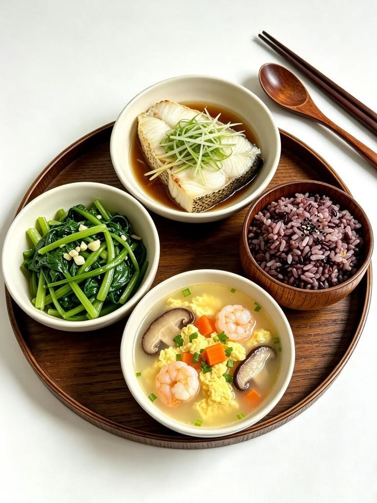

治愈的饭不用复杂：一块鱼、一把青菜、一碗饭，蒸的蒸、炒的炒，端上桌还是热的。这样的搭配，看着就让人安心。

第一套盛在白托盘里。两片清蒸的鱼并排躺着，鱼皮还带着光泽，盘底的蒸鱼汁清清亮亮，只撒几根葱丝提味；旁边一盘蒜蓉西兰花苔，绿得发亮，蒜末金黄；再配一碗压得圆圆的白米饭。鱼的鲜、菜的脆、饭的香，各是各的味道，谁也不抢谁的。

第二套换了圆木托盘，丰盛一点。鱼还是一整块蒸的，葱丝铺得满满当当；绿叶菜用蒜蓉快炒，油亮亮的；多了一碗虾仁香菇蛋花汤——蛋花嫩黄、虾仁粉白、香菇切得厚厚的；主食换成紫米饭，盛在小木碗里，配一双木筷、一把木勺。多一道汤，整顿饭的节奏就慢下来了。

一鱼一蔬一碗饭，是最经得起天天吃的搭配：不油腻，不将就，清清爽爽，把日子过成喜欢的样子。