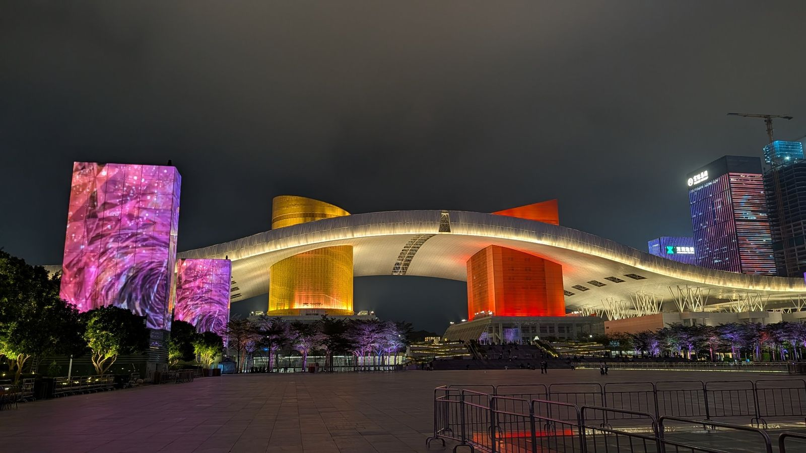
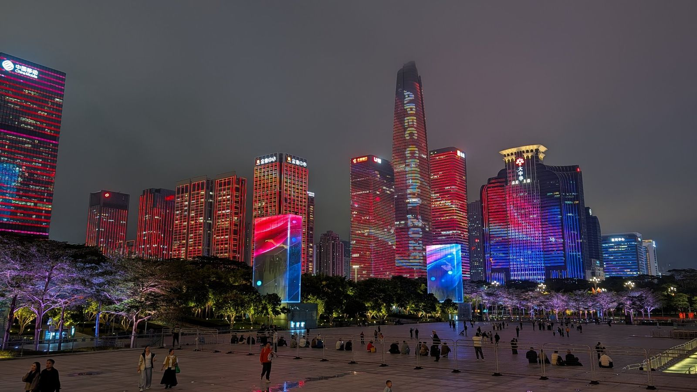
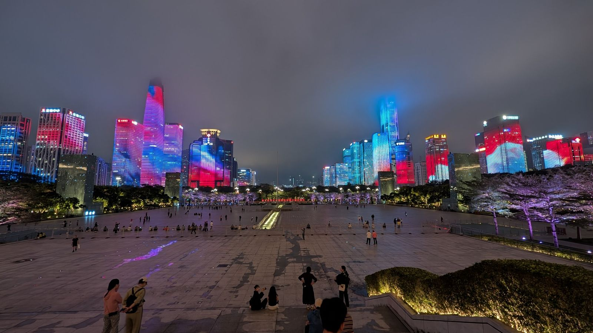

小雪刚过，深圳福田市民广场的灯光秀入夜亮起。这是 2026 年 11 月 23 日夜里，在市民中心一带拍下的三张照片。

<figure>
<video class="warm" style="width:100%;height:auto;display:block" controls preload="none" playsinline poster="/assets/img/shenzhen-civic-night-poster.jpg" src="/assets/video/shenzhen-civic-night-narrated.mp4"></video>
<figcaption>市民中心灯光秀 · 配音版（2 分钟）：从白天的市民中心与莲花山，到入夜的灯光秀</figcaption>
</figure>
<figure>
<video class="warm" style="width:100%;height:auto;display:block" controls preload="none" playsinline poster="/assets/img/shenzhen-civic-night-1.jpg" src="/assets/video/shenzhen-civic-night.mp4"></video>
<figcaption>市民中心灯光秀 · 原始片段 14 秒</figcaption>
</figure>
<figure>

<figcaption>市民中心‘大鹏展翅’的弧形屋顶覆着暖金色的光，左侧楼体打着紫粉色的流动光影，广场上人不多，夜色很静。</figcaption>
</figure>
<figure>

<figcaption>广场对岸的高楼整片亮起红色，中间最高的是平安金融中心，塔尖没入低低的云里。</figcaption>
</figure>
<figure>

<figcaption>站在广场中轴线上，两侧天际线都披着灯光秀的色彩，人们三三两两坐在台阶上，慢慢看。</figcaption>
</figure>

摄于 2026 年 11 月 23 日夜 · 深圳福田

