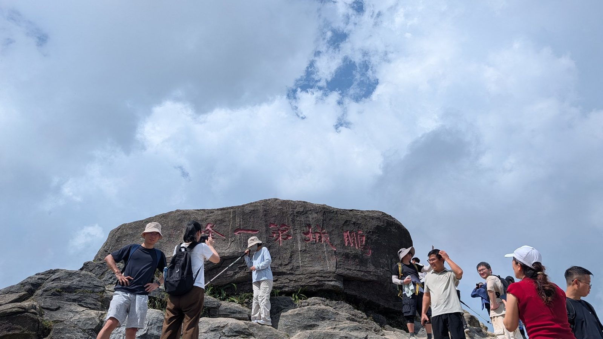
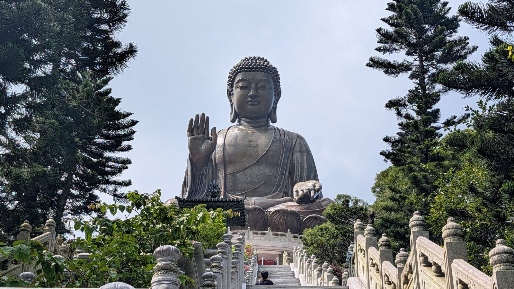

一段 28 秒的短片，把今天的两座山剪在了一起：前半段是深圳梧桐山——山顶望出去的城市天际线、小梧桐上的梧桐阁、林子里的石阶；后半段是香港昂坪——大佛座前的六天母像、山坳里的宝莲禅寺，最后是大佛本人，仰头望去，云就在他肩上飘。

<video class="warm" style="width:100%;height:auto;display:block" controls preload="none" playsinline poster="/assets/uploads/clouds-cover.jpg" src="/assets/video/mountains-clouds.mp4"></video>

照片版的这两座山，在《梧桐山：从好汉坡到鹏城第一峰》和《天坛大佛：二百六十八级台阶之上》两篇里。山在云上，云在山间——爬山这件事，爬的原来是云。
