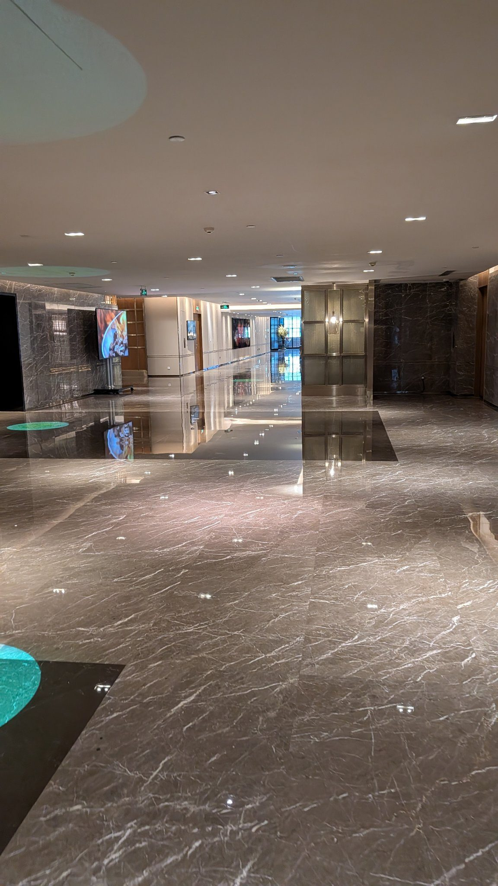
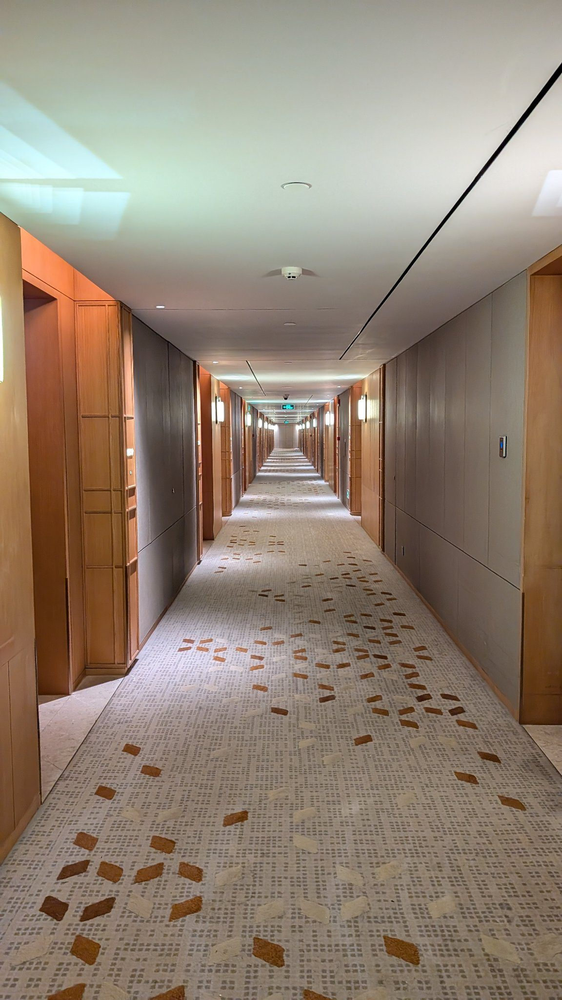
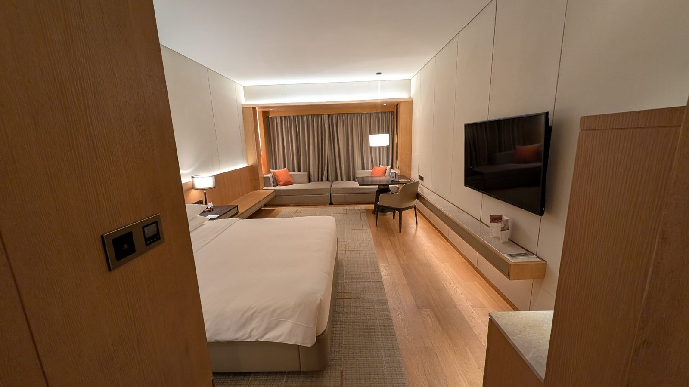
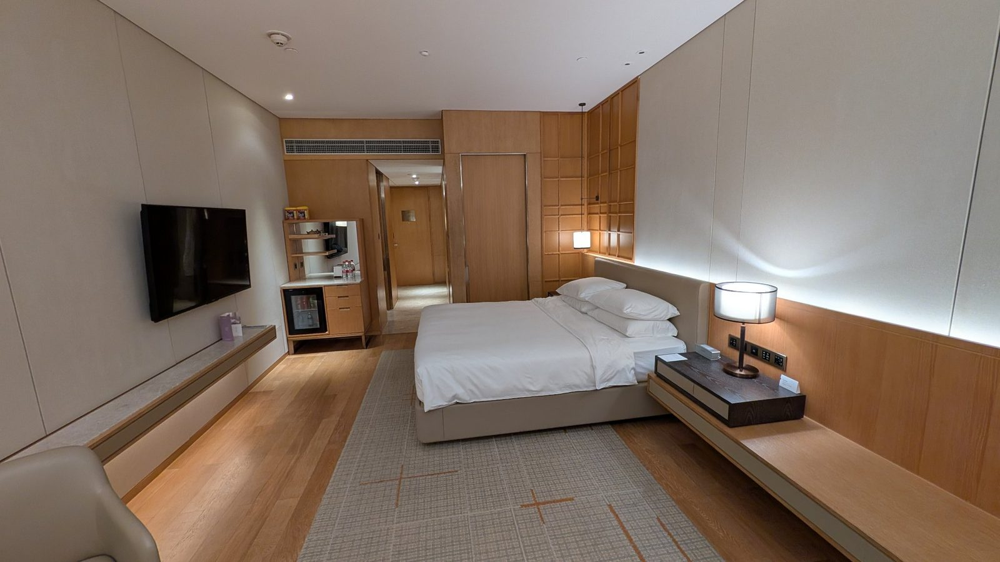
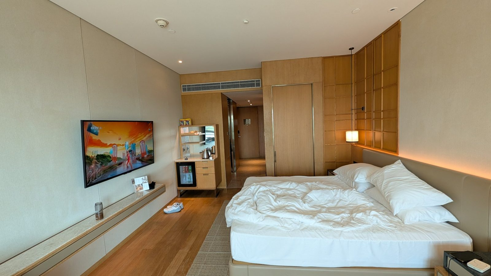

这组照片记的是一次深圳旅行住的酒店：亮得能照出灯影的大理石地面，一条长长的走廊，和一间原木色的房间。

大堂和公共区域铺着深色大理石，石纹像水波一样漫开，地面亮得像镜子，墙上的屏幕和头顶的灯都映在上面。人走在上面，脚步声都显得轻。

客房走廊很长，长得一眼望不到头。地毯是米白的底子，撒着棕色的小块花纹；两边原木门框配着灰墙，壁灯一盏挨着一盏往前排。

房间是原木与米白的：木地板、浅色墙板，床尾铺一条长地毯。窗边做了一排卡座，配一张小桌，橘色的靠垫是全屋唯一跳出来的颜色——其余的，都安安静静。

灯亮起来的时候，床头背景的木格栅透出暖光，床铺得整整齐齐，台灯的光落在床头柜上。刚进门那一刻的房间，是它最体面的样子。

住下来就成了另一个样子：被子睡乱了，鞋踢在电视柜边上，电视还开着。出门旅行住酒店，最真实的模样大概就是这一张——体面是进门那会儿的，住进去，全是自己的日子。
