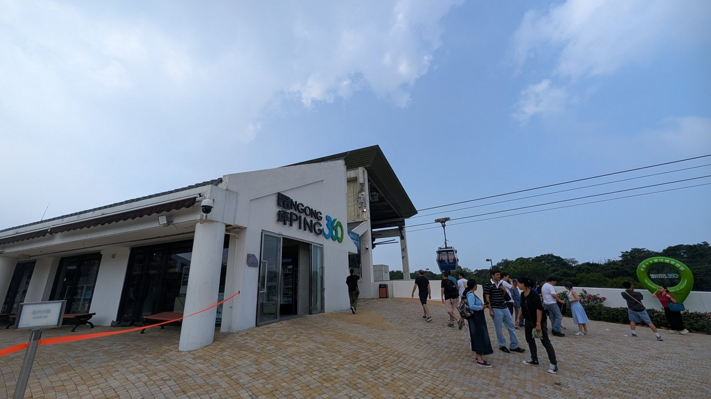
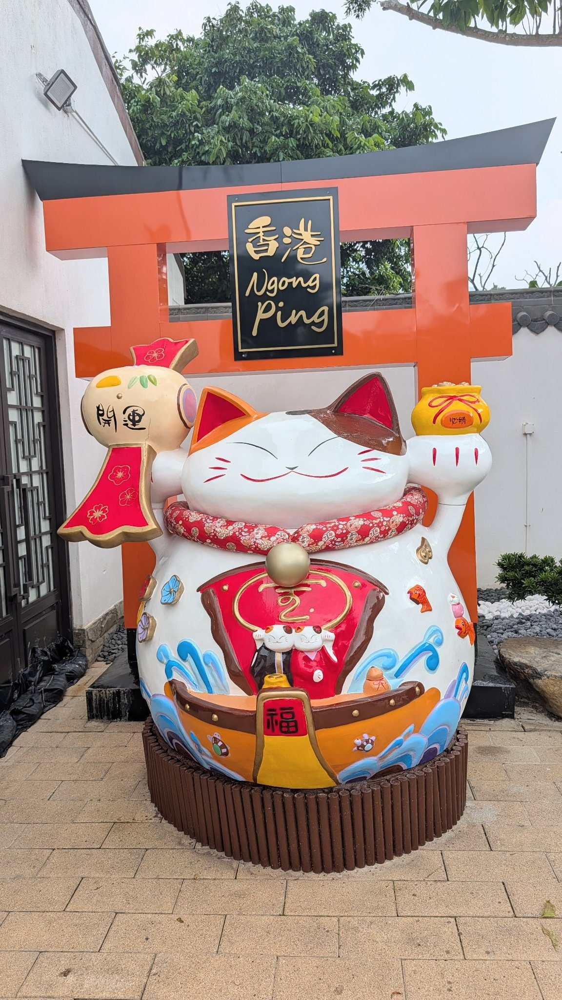
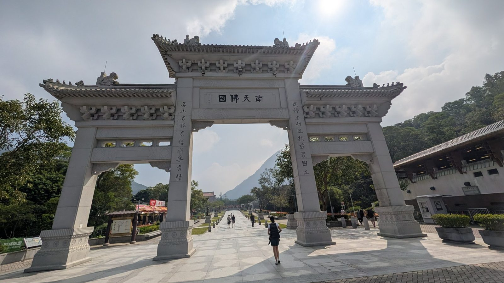
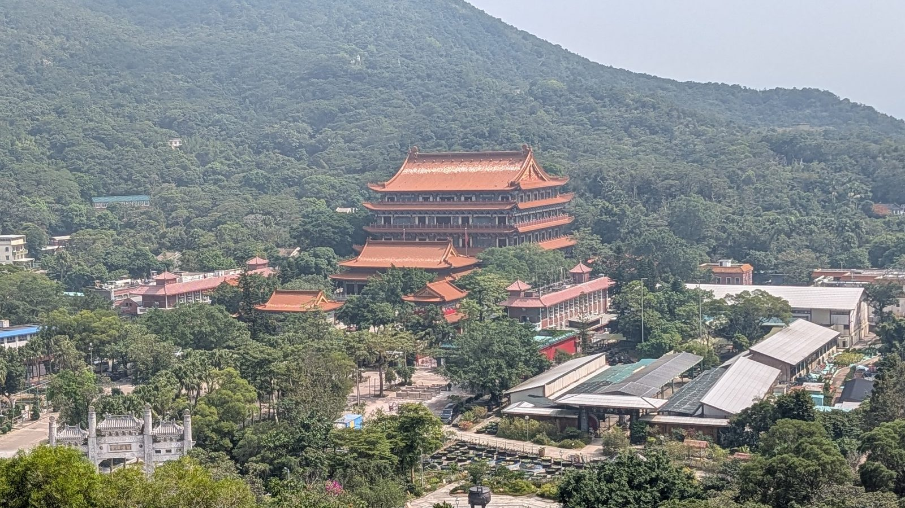
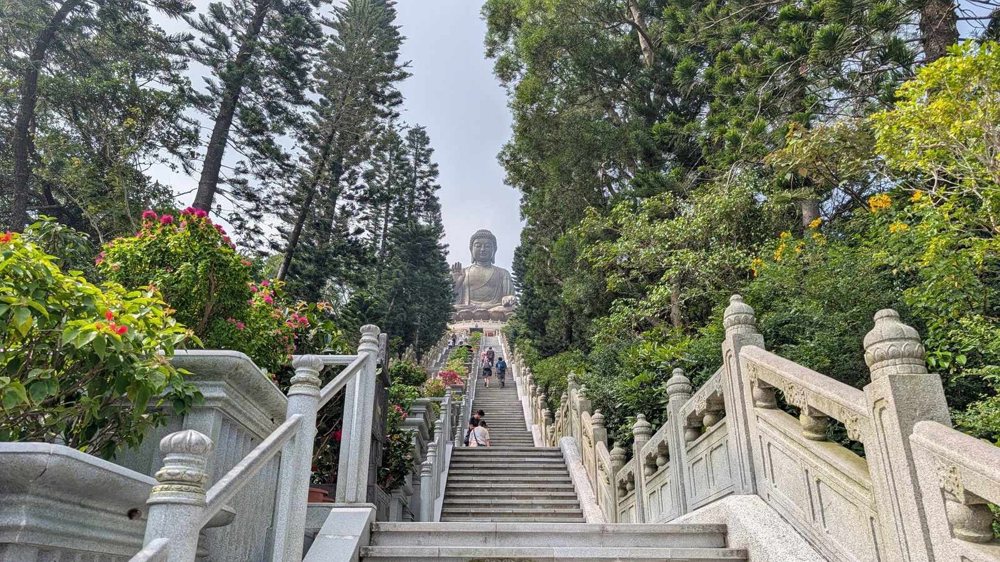
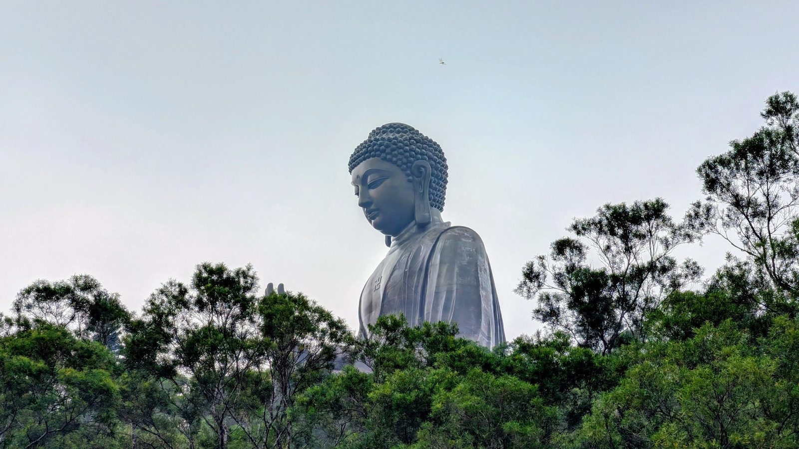
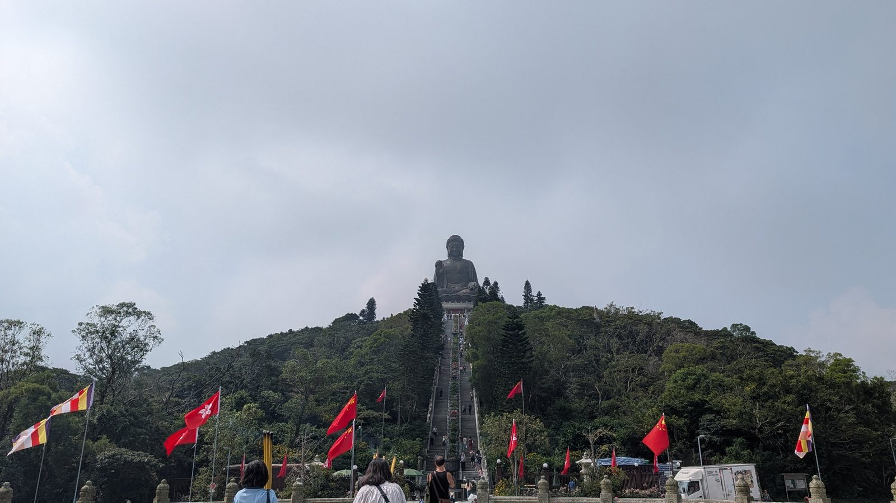

这组照片是香港大屿山昂坪的天坛大佛：从昂坪 360 的缆车站出来，穿过市集和「南天佛国」牌坊，再爬上 268 级台阶，大佛就坐在云端里。

昂坪 360 是上山的那条缆车。站房不大，门口散着刚下车的人，头顶一辆缆车正滑进站——山里的天，一下子就开阔了。

市集里有一只巨大的招财猫，站在写着「香港 Ngong Ping」的朱红牌子下：一只爪子举着金元宝，一只抱着写了「開運」的牌子，笑眯眯地迎人。

穿过市集，是宝莲禅寺的牌坊，横额「南天佛国」四个字。两边楹联写得很有气势：「建佛建刹建校莊嚴國土，名山名勝名僧利樂有情」。

站在高处回望，宝莲禅寺铺在山坳里：橙红色的屋顶一层叠一层，背靠着大屿山的绿。寺前那座牌坊小小的，就是刚才穿过的那一座。

去大佛要爬 268 级台阶。石栏一路向上，两边是高大的松树和开着的簕杜鹃，大佛在尽头坐着，越爬越近。

爬到最后一级，大佛就在眼前：右手抬起，左手安放在膝上。青铜的像身在这里坐了三十多年，颜色沉得像山本身。

从侧面看，大佛的轮廓压在天上，垂着长长的耳朵，眼睛半闭。树梢只到他的肩膀——在山下觉得高的大树，在他旁边都成了陪衬。

退到菩提大道上再看：大佛坐在山顶正中，长长的台阶从山脚直通到他座下，国旗、区旗和佛教的旗子在两边飘着。这一眼，才看得出他为什么叫「天坛」——像从天上，落到了山里。
