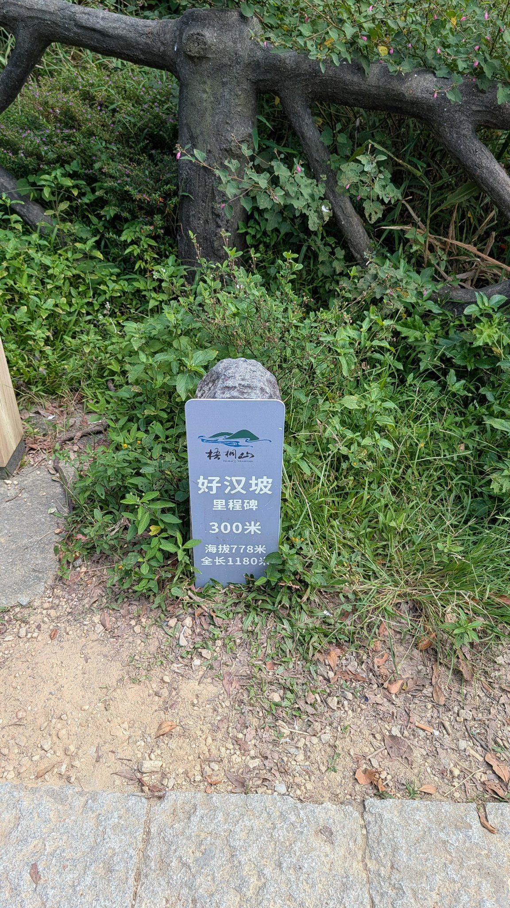
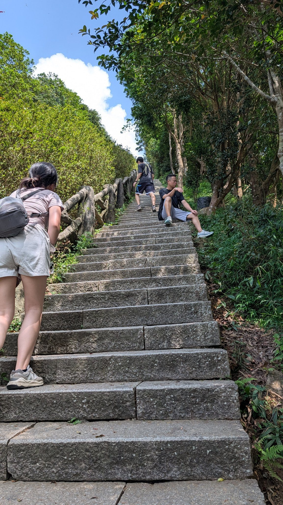
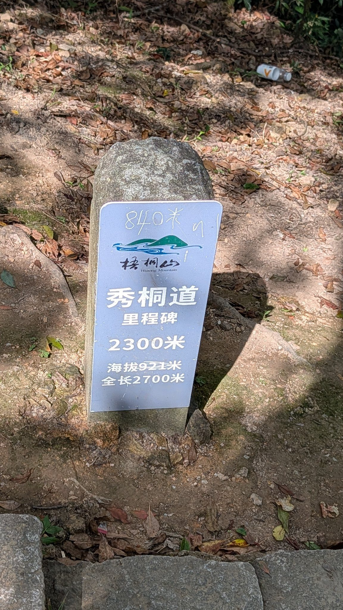
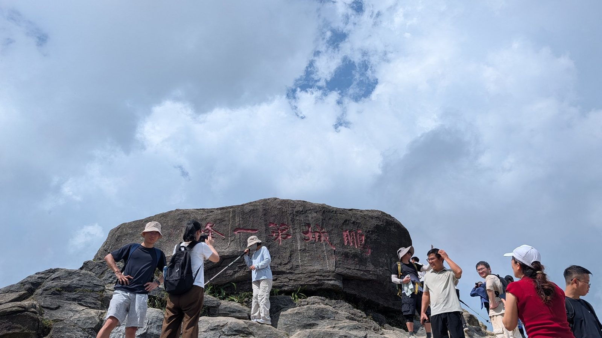
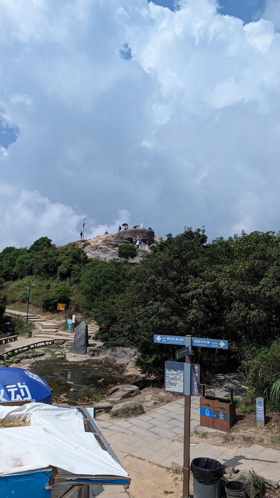
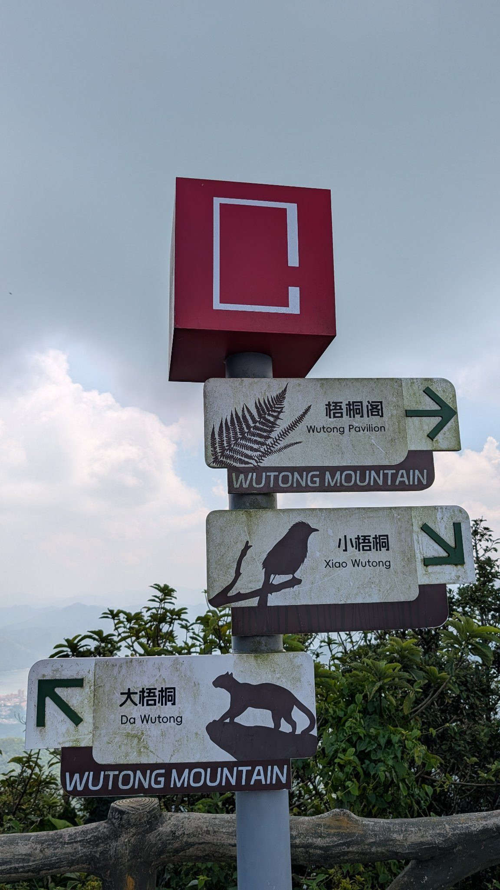
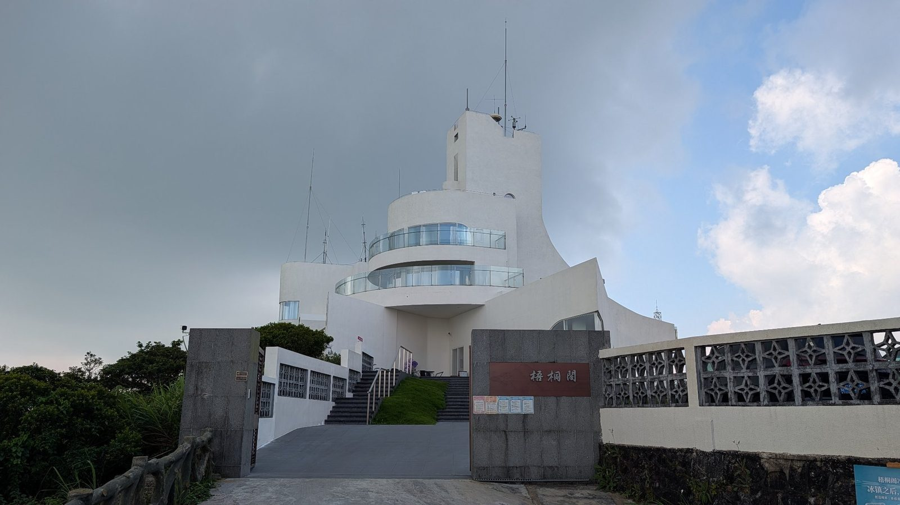
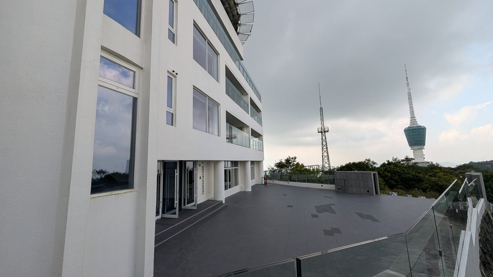

梧桐山是深圳的最高处。这组照片从半山的里程碑开始，一级一级往上：好汉坡的石阶、秀桐道的牌子、大梧桐顶上刻着「鹏城第一峰」的大石，再绕到小梧桐的梧桐阁。

好汉坡的里程碑立在草丛里：全长 1180 米，这块牌子在 300 米处，海拔已经 778 米。名字起得直白——敢往上走的，都是好汉。

台阶是整块的石头砌的，又陡又长，一眼望不到头。爬的人不少，中途坐在台阶边歇脚的也不少；两边的树把太阳挡了大半，只漏下一点光。

另一条上山路是秀桐道，全长 2700 米，这块里程碑在 2300 米处，离山顶只剩最后 400 米。牌面被人添了几笔涂改，是山里常见的事，倒给这块石头添了点人气。

大梧桐顶上是一块巨石，刻着「鹏城第一峰」五个红字。爬到顶的人都要在石头前站一会儿，拍张照——头顶就是大片的云，风把云吹得很快。

从山腰回望山顶，巨石上站满了小小的人。山坳里有一口小池塘，旁边的路牌一边指向攀云径、泰山涧，一边指向盐田、沙头角——一座山，把城市和海都连上了。

山里的指路牌做得用心：梧桐阁配一片蕨叶，小梧桐配一只鸟，大梧桐配一只豹猫——都是这座山里能遇见的生灵。

小梧桐顶上是梧桐阁，一栋白色的现代建筑，弧形的玻璃幕墙一层层退上去，立在云底下，像一艘停在山顶的船。

<video class="warm" style="width:100%;height:auto;display:block" controls preload="none" playsinline poster="/assets/uploads/wutongshan-8.jpg" src="/assets/video/wutongshan-ge.mp4"></video>

梧桐阁前的平台空无一人，玻璃栏杆外就是深圳电视塔，立在小梧桐的另一个山头上，和梧桐阁隔空相望。深圳的高楼都踩在脚下，山上只有台阶、里程碑和风——爬一次梧桐山，像把这座城市翻了个面。
